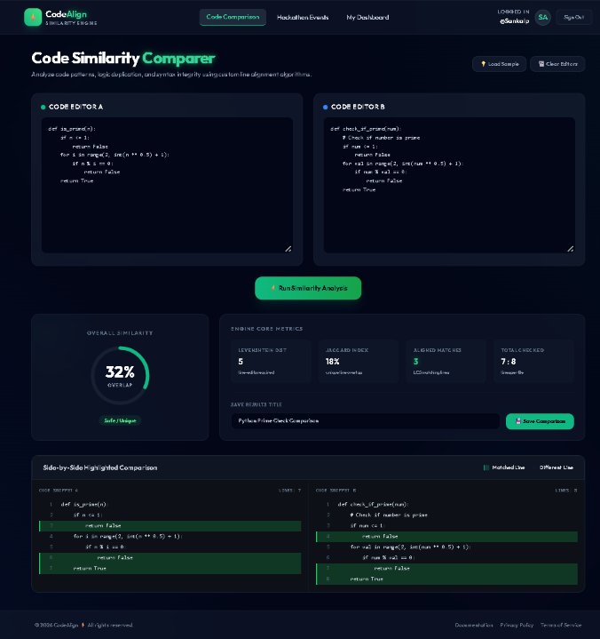

# CodeAlign – Code Similarity Engine

A MERN-stack web app for comparing two code snippets for similarity and plagiarism, with a hackathon events section, user accounts and a personal dashboard.

**Live demo:** https://code-plagiarism-checker-eight.vercel.app

> The backend runs on a free plan and sleeps when idle, so the first login can take up to a minute. After that it's fast.

## Features
- Side-by-side comparison with an overall similarity score (0–100%)
- Score breakdown: Levenshtein distance, Jaccard index, matched lines, total lines
- Matching lines highlighted in both snippets
- Save comparisons with a title and revisit them from your dashboard
- Sign up / log in with JWT authentication, and edit your profile
- Hackathon events: browse, and create, edit or delete when logged in

## Try the demo
The live site and the seeded database include a demo account and sample events:

- **Email:** `organizer@hackathon.com`
- **Password:** `password123`

Click **Load Sample** on the comparer page to fill both editors with example code, then **Run Similarity Analysis**. This is a shared demo account, so don't save anything private in it.

## How the score works
Comparison is line based, with leading and trailing whitespace trimmed. Three algorithms run on every pair:

1. **Levenshtein distance:** the number of line insertions, deletions or substitutions needed to turn A into B. Sensitive to line order.
2. **Jaccard index:** overlap between the sets of unique non-empty lines, ignoring order.
3. **Longest common subsequence (LCS):** finds the lines that match in order. These are the highlighted lines.

**Overall score = 70% Levenshtein similarity + 30% Jaccard similarity.**

Because whole lines are compared, a copy with renamed variables or reformatted lines will score low (the screenshot below shows identical logic scoring 32%). Treat the score as a first-pass signal, not proof of plagiarism.

## Tech Stack
- **Frontend:** React, Vite, Tailwind CSS
- **Backend:** Node.js, Express
- **Database:** MongoDB (Mongoose)
- **Auth:** JSON Web Tokens, bcryptjs

## Deployment
- **Frontend:** Vercel
- **Backend (API):** Render
- **Database:** MongoDB Atlas

Pushing to `main` redeploys the frontend and backend automatically. The frontend reaches the backend through the `VITE_API_URL` environment variable. Atlas allows `0.0.0.0/0` so the hosted backend can connect, and the database is still protected by its username and password.

## Run it locally

**Prerequisites:** [Node.js](https://nodejs.org) (LTS) and either [MongoDB Community Server](https://www.mongodb.com/try/download/community) running locally or a MongoDB Atlas connection string.

### 1. Clone the repo
```bash
git clone https://github.com/SankalpShanbhag13/code-plagiarism-checker.git
cd code-plagiarism-checker
```

### 2. Backend
```bash
cd backend
npm install
```
Create `backend/.env` (copy `.env.example`):
```
PORT=5000
MONGO_URI=mongodb://127.0.0.1:27017/code_similarity_db
JWT_SECRET=change_this_to_a_long_random_string
```
Optionally load the demo data (**this clears existing users, events and submissions**), then start the server:
```bash
npm run seed
npm run dev
```
The API runs on http://localhost:5000.

### 3. Frontend
In a second terminal:
```bash
cd frontend
npm install
npm run dev
```
Open http://localhost:3000. The frontend uses `http://localhost:5000` by default; set `VITE_API_URL` to point elsewhere.

## Project Structure
```
backend/    Express API (routes, models, middleware, seeder)
frontend/   React + Vite app
docs/       Screenshots
```

## Troubleshooting
- **Database connection error:** start MongoDB locally, or add your IP to the Atlas access list.
- **`npm` blocked in PowerShell:** run `Set-ExecutionPolicy -Scope CurrentUser RemoteSigned`, then reopen the terminal.
- **Live demo slow on first load:** the free backend is waking up; wait a minute and retry.

## Screenshot


